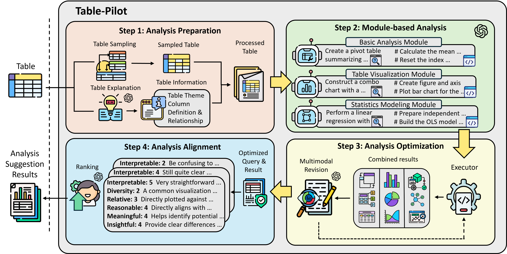

# TablePilot: Recommending Human-Preferred Tabular Data Analysis with Large Language Models

[](https://www.arxiv.org/pdf/2503.13262)

We propose TablePilot, a pioneering tabular data analysis framework leveraging large language models to autonomously generate comprehensive and superior analytical results without relying on user profiles or prior interactions. The framework incorporates key designs in analysis preparation and analysis optimization to enhance accuracy. Additionally, we construct DART, a benchmark tailored for comprehensive tabular data analysis recommendation.

<div align="center">
  
</div>

## Quick Start 🚀

### Step 1: Build Environment
```bash
conda create -n tablepilot
conda activate tablepilot

pip install -r requirements.txt
```

### Step 2: Tabular Data Process
```bash
cd data_process
bash table_txt_fmt.sh
```

### Step 3: Analysis Generation
This step is the core generation component of TablePilot and consists of two main phases:

1. **Table Explanation Generation**
2. **Module-based Analysis Generation**, which includes three parts:
   - Basic Analysis  
   - Visualization  
   - Modeling

Replace the corresponding `.py` files as needed to generate specific content, then run:

```bash
bash run_generation.sh
```

### Step 4: Analysis Optimization
We employ a multimodal revision approach to refine the generated data analysis operations.
- Before revision, we first obtain the execution results of the initial round of generated data analysis operations
```bash
cd execution/run
bash run_code_exec_error.sh
```

- After that, we perform optimization based on these results
```bash
cd generation/run
bash run_revision.sh
```

- We perform only a single round of revision to obtain the final optimized results
```bash
cd execution/run
bash run_code_exec_revision.sh
```

### Step 5: Analysis Ranking
After optimization, the ranking module is used to return the highest-quality recommendations.

- We first need to aggregate all the results from the module-based analysis
```bash
cd evaluation/run
bash run_process_module_res.sh
```

- Then we apply the ranking module to return the highest-quality recommendations
```bash
cd generation/run
bash run_rank.sh
```

### Step 6: Evaluation
- **Execution Rate**
```bash
cd evaluation/run
bash run_exec_rate.sh
```

- **Recall**
  - Total Recall, the overall recall of all results generated by the framework
    ```bash
    bash run_recall_all_results,sh
    ```

  - Recall@k, where k represents the number of recommended data analysis operations the user wishes to receive
    ```bash
    bash run_sum_ranking_res.sh
    bash run_recall_ranked_res.sh
    ```

## Citation
If you find this repository useful, please considering giving ⭐ or citing:
```
@article{yi2025tablepilot,
  title={TablePilot; Recommending Human-Preferred Tabular Data Analysis with Large Language Models},
  author={Yi, Deyin and Liu, Yihao and Cao, Lang and Zhou, Mengyu and Dong, Haoyu and Han, Shi and Zhang, Dongmei},
  journal={arXiv preprint arXiv:2503.13262},
  year={2025}
}
```

## Contributing

This project welcomes contributions and suggestions.  Most contributions require you to agree to a
Contributor License Agreement (CLA) declaring that you have the right to, and actually do, grant us
the rights to use your contribution. For details, visit https://cla.opensource.microsoft.com.

When you submit a pull request, a CLA bot will automatically determine whether you need to provide
a CLA and decorate the PR appropriately (e.g., status check, comment). Simply follow the instructions
provided by the bot. You will only need to do this once across all repos using our CLA.

This project has adopted the [Microsoft Open Source Code of Conduct](https://opensource.microsoft.com/codeofconduct/).
For more information see the [Code of Conduct FAQ](https://opensource.microsoft.com/codeofconduct/faq/) or
contact [opencode@microsoft.com](mailto:opencode@microsoft.com) with any additional questions or comments.

## Trademarks

This project may contain trademarks or logos for projects, products, or services. Authorized use of Microsoft 
trademarks or logos is subject to and must follow 
[Microsoft's Trademark & Brand Guidelines](https://www.microsoft.com/en-us/legal/intellectualproperty/trademarks/usage/general).
Use of Microsoft trademarks or logos in modified versions of this project must not cause confusion or imply Microsoft sponsorship.
Any use of third-party trademarks or logos are subject to those third-party's policies.
